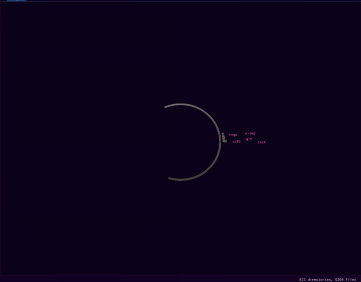
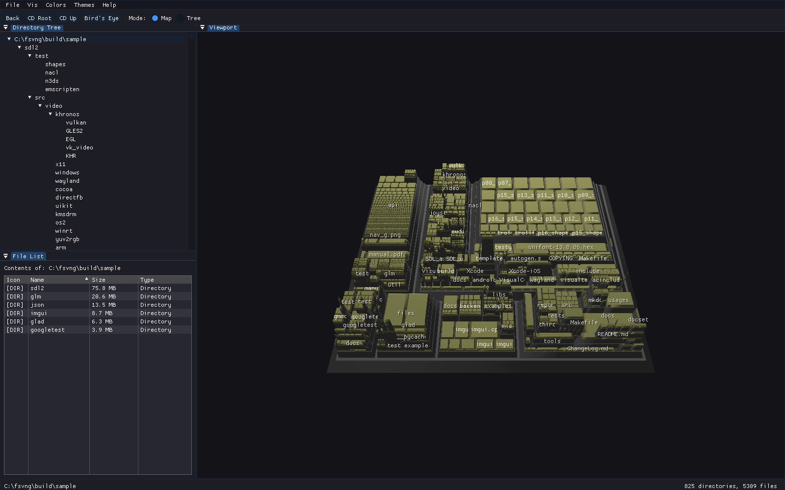
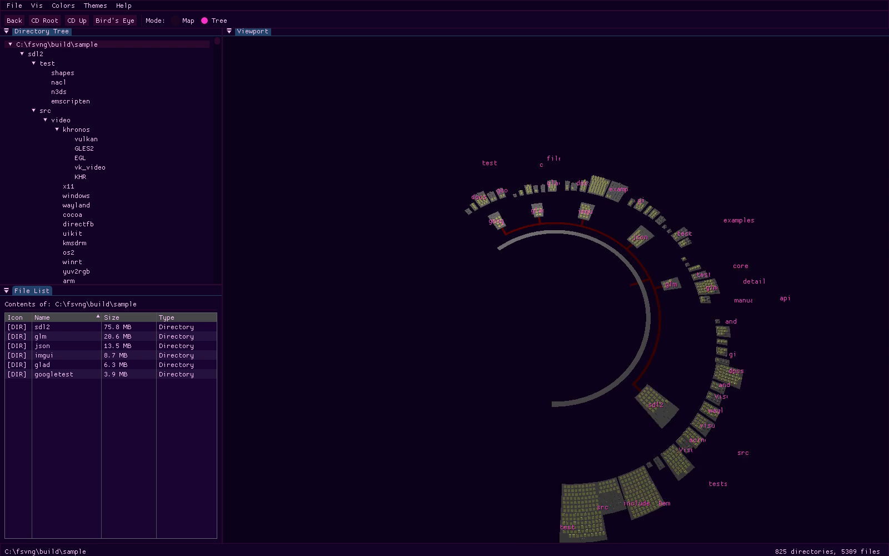

# fsvng

[](https://github.com/sp00nznet/fsvng/actions/workflows/ci.yml)

fsvng shows a folder as a 3D landscape you can fly through: every file is a block sized by how
big it is, every folder a platform holding its contents. It is a C++17 rewrite of
[fsv](http://fsv.sourceforge.net/), the 1999 3D File System Visualizer, for Windows, macOS and
Linux.

<p align="center">
  
</p>

## Status

**v0.10.0, alpha.** Windows is where fsvng is used day to day. The Linux and macOS builds compile
and pass the test suite in CI on every push, but haven't been run by hand yet; reports welcome.
Two of fsv's views are here: **MapV** (nested treemap) and **TreeV** (radial tree). fsv's third,
DiscV, was ported and then removed. See [ROADMAP.md](ROADMAP.md) for what's next.

## Screenshots

<p align="center">
  <br>
  <em>MapV: each folder is a raised platform and each file a block on it, sized by bytes.
  The sources of SDL2, Dear ImGui, GLM, nlohmann/json, glad and GoogleTest, fully expanded.</em>
</p>

<p align="center">
  <br>
  <em>TreeV, Synthwave theme: the same tree as rings, each folder's contents one ring further out.</em>
</p>

## Getting Started

### Quick start: download and run

1. Open [Releases](https://github.com/sp00nznet/fsvng/releases/latest) and download the archive
   for your system: `fsvng-v0.10.0-windows-x64.zip`, `fsvng-v0.10.0-linux-x64.tar.gz` or
   `fsvng-v0.10.0-macos-arm64.tar.gz` (Apple Silicon).
2. Unpack it anywhere. Keep `fsvng` and the `shaders` folder side by side.
3. Run it:
   - **Windows:** drag a folder onto `fsvng.exe`. (Double-clicking it shows the folder it sits in;
     pick another with File > Change Root.) The binary isn't signed, so SmartScreen may ask:
     More info > Run anyway.
   - **Linux:** `./fsvng ~/Documents`. Needs an OpenGL 3.3 driver and glibc 2.35 or newer
     (Ubuntu 22.04, Debian 12, Fedora 36, or later).
   - **macOS:** the binary isn't signed, so clear the download quarantine first:
     ```
     cd fsvng-v0.10.0-macos-arm64
     xattr -dr com.apple.quarantine .
     ./fsvng ~/Documents
     ```

A window opens, the status bar counts files while the folder is scanned, and the view appears.
Large folders (hundreds of thousands of files) take a while to scan.

### Step by step: build from source

Prerequisites: CMake 3.20+, a C++17 compiler (Visual Studio 2022, GCC 9+ or Clang 10+), Python 3
with `jinja2` (`pip install jinja2`; glad uses it to generate the OpenGL loader), git, and an
internet connection for the first configure, which downloads SDL2, ImGui, GLM, glad and
nlohmann/json. On Linux, SDL2 also needs the X11/Wayland headers listed in
[docs/building.md](docs/building.md).

1. Clone:
   ```
   git clone https://github.com/sp00nznet/fsvng.git
   cd fsvng
   ```
2. Configure. The last line should be `-- Build files have been written to: .../fsvng/build`.
   ```
   cmake -B build -DCMAKE_BUILD_TYPE=Release -DFSVNG_BUILD_TESTS=ON
   ```
3. Build:
   ```
   cmake --build build --config Release --parallel
   ```
4. Test. Expect `100% tests passed, 0 tests failed out of 7`.
   ```
   ctest --test-dir build --build-config Release
   ```
5. Run: `build\src\Release\fsvng.exe C:\some\folder` on Windows (Visual Studio generator),
   `./build/src/fsvng ~/some/folder` elsewhere.

Trip-ups: `ModuleNotFoundError: No module named 'jinja2'` during the build means CMake found a
Python without jinja2. Install it into that one, or pass `-DPython_EXECUTABLE=` the Python that has
it. More in [docs/building.md](docs/building.md).

## Usage

```
fsvng [--expand-all] [folder]
```

- `fsvng D:\Projects` shows `D:\Projects`. With no folder, fsvng shows the default path
  (File > Set Default Path), or else the current folder.
- `fsvng --expand-all ~/src` expands every folder after the scan, so the whole tree grows in at
  once. The same is in the right-click menu as **Expand All**, for any folder.

| Input | Action |
|-------|--------|
| Left drag | Orbit the camera |
| Right drag | Pan the camera |
| Right click | Context menu: Expand, Expand All, Collapse, Scan as Root, Look At, Copy Path, Properties. On Windows also Open and the Explorer right-click menu |
| Scroll wheel | Zoom |
| W/S or Up/Down | Fly forward/back |
| A/D or Left/Right | Strafe |
| Q/E | Down/up |
| Double-click (MapV) | Fly to the folder or file under the cursor |
| Enter | Expand/collapse the current folder |
| Backspace | Back |
| Escape | Up to the parent folder |
| Toolbar: Bird's Eye | Toggle the overhead view |

**Vis** switches between MapV and TreeV. **Colors** colors files by type, by age, or by filename
pattern (Configure Colors... edits the patterns). **Themes** has Classic, Tron, Matrix, Synthwave
and Ember. The view, color mode, theme and window size are remembered in `config.json`:
`%APPDATA%\fsvng` on Windows, `~/Library/Application Support/fsvng` on macOS,
`~/.config/fsvng` (or `$XDG_CONFIG_HOME/fsvng`) on Linux.

### In the browser

fsvng also builds with Emscripten, to WebGL 2. Try it at [sp00.nz/#fsvng](https://sp00.nz/#fsvng).
A page can't read your disk, so the web build bundles one folder. See
[docs/building.md](docs/building.md#browser-emscripten).

## Building from source

The short version is under Getting Started. [docs/building.md](docs/building.md) has every
platform, the browser build, and troubleshooting. The design is in
[docs/architecture.md](docs/architecture.md), what came over from fsv and what changed is in
[docs/porting.md](docs/porting.md), and the TreeV layout and camera traps are in
[docs/treev.md](docs/treev.md). How the screenshots above are made: [docs/screenshots.md](docs/screenshots.md).

## License

LGPL-2.1-or-later, the same as the original fsv (LGPL version 2 "or any later version"). See
[LICENSE](LICENSE). Release binaries also contain SDL2, Dear ImGui, GLM, glad and nlohmann/json;
[NOTICE](NOTICE) lists them, and why the binaries go out under LGPL version 3.

The original **fsv** is by Daniel Richard G. (1999), written for GTK+ 1.2 and fixed-function
OpenGL. Its layout, camera and animation algorithms are ported here; everything around them is new.
