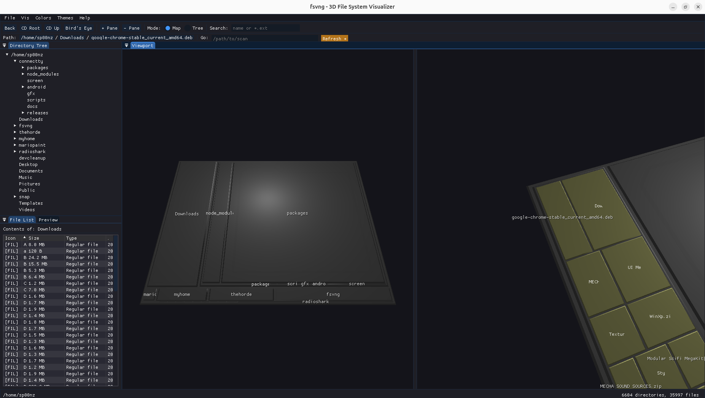
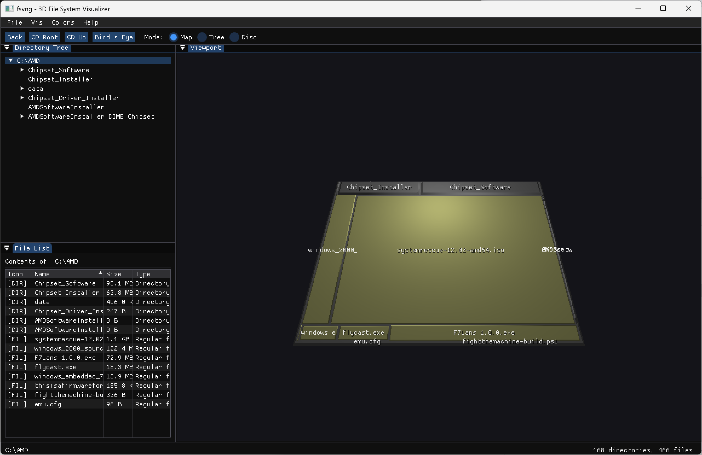
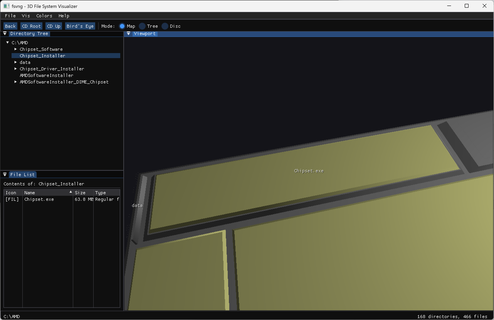

# fsvng

### Your filesystem, but make it *three-dimensional*

**fsvng** is a from-scratch C++17 rewrite of [fsv](http://fsv.sourceforge.net/), the legendary 1999 3D file system visualizer. It turns your directory listings into navigable 3D landscapes — and now works as a real file explorer, with multiple panes, search, previews, and drag-and-drop.


<p align="center">
  
</p>
<p align="center">
  <em>Two panes side by side — drag files from one into the other to move them.</em>
</p>

---

## What does it do?

Point fsvng at any directory and watch it build a 3D visualization of your filesystem. Navigate through your files the way nature intended: by flying a camera through a city of colored blocks — then act on them like you would in any file manager.

<p align="center">
  <br>
  <em>MapV — nested treemap showing directory structure as 3D boxes</em>
</p>

<p align="center">
  <br>
  <em>Zoomed in — double-click to navigate into directories and inspect individual files</em>
</p>

**Two visualization modes:**

| Mode | What it looks like | Best for |
|------|-------------------|----------|
| **MapV** | Nested treemap of 3D boxes | Seeing where your disk space went |
| **TreeV** | Radial platforms spiraling upward | Understanding directory hierarchy |

**Color modes:** by file type, by modification timestamp, or by wildcard pattern matching.

---

## File-explorer features

fsvng is a navigable visualizer *and* a working file manager:

- **Multi-pane** — split into up to **4 panes** in a grid, each showing a different directory with its own camera and view mode.
- **Drag-and-drop** — drag files from one pane's file list onto another pane (or a folder) to **move** them. Multi-selection drags move everything at once.
- **Search / filter** — type a name or `*.ext` glob; matching nodes glow in the 3D scene with a live match count.
- **Breadcrumb + address bar** — click a path segment to jump to an ancestor, or paste a path into **Go:** to scan it.
- **File operations** — **Rename**, **New Folder**, and **Move to Trash** (via `gio`, so deletes are recoverable). Navigation, open folders and camera are preserved across the refresh.
- **Multi-select** — `Ctrl`-click to toggle, `Shift`-click for a range; batch trash or move the selection.
- **Quick preview** — a Preview tab shows text file contents or an image thumbnail for the selected file.
- **Live refresh** — an `inotify` watcher lights up a **Refresh** button when the tree changes on disk; optional auto-refresh.
- **Sortable file list** — sort by name, size, type, or modified date.
- **Reveal in File Manager / Open Terminal Here / Open** — hand a file or folder off to your desktop (right-click menu).
- **Show Hidden Files** — toggle dotfiles on/off (File menu).

---

## Quick Start

```bash
# Clone
git clone https://github.com/sp00nznet/fsvng.git
cd fsvng

# Linux: install build tools + SDL2 deps (see install-deps.sh)
sudo apt install cmake ninja-build build-essential libgl-dev \
    libx11-dev libxext-dev libxrandr-dev libxcursor-dev libxi-dev \
    libxfixes-dev libxss-dev libxkbcommon-dev libwayland-dev
# (a convenience script is provided: ./install-deps.sh)

# Build (all libraries auto-fetched via CMake FetchContent)
cmake -B build -DCMAKE_BUILD_TYPE=Release -DFSVNG_BUILD_TESTS=ON
cmake --build build -j

# Run
./build/src/fsvng                  # Linux/macOS
./build/src/Release/fsvng.exe      # Windows

# Or point it at a specific directory
./build/src/fsvng ~/Projects
```

For deletes to go to Trash, install `gio` (part of `glib2` / `libglib2.0-bin`) — without it, the Trash action is disabled rather than deleting permanently.

### Prerequisites

- **CMake** 3.20+
- **C++17 compiler** (GCC 9+, Clang 10+, or MSVC 2019+)
- **OpenGL 3.3** capable GPU and drivers
- Everything else is fetched automatically on first build.

See [docs/BUILDING.md](docs/BUILDING.md) for per-platform details.

---

## Controls

| Input | Action |
|-------|--------|
| **Left drag** | Orbit camera |
| **Right drag** | Pan camera |
| **Scroll wheel** | Zoom in/out |
| **W/S or Up/Down** | Dolly forward/back |
| **A/D or Left/Right** | Strafe left/right |
| **Q/E** | Move up/down |
| **Double-click** | Navigate into directory / open file |
| **Enter** | Expand/collapse current directory |
| **Backspace** | Navigate back |
| **Right-click** | Context menu (open, reveal, terminal, rename, new folder, trash) |
| **Click tree / file row** | Navigate / select (Ctrl/Shift for multi-select) |
| **Drag file → pane** | Move into that pane's directory |
| **Toolbar: + Pane / − Pane** | Add / close a pane |
| **Toolbar: Bird's Eye** | Toggle overhead view |

Click a pane to focus it; the Directory Tree, File List and Preview panels follow the focused pane.

---

## Tech Stack

All dependencies are fetched at build time. Zero manual installs.

| Component | Library |
|-----------|---------|
| Windowing | SDL2 |
| GUI | Dear ImGui (docking branch) |
| 3D Rendering | OpenGL 3.3 Core + custom shaders |
| GL Loading | glad |
| Math | GLM |
| Config | nlohmann/json |
| Image preview | stb_image |
| Testing | Google Test |

---

## Project Structure

```
fsvng/
  cmake/             CMake dependency fetching
  shaders/           GLSL vertex/fragment shaders
  src/
    app/             Application lifecycle + config
    core/            FsNode, FsTree, scanner, watcher, file ops
    scene/           Scene + SceneManager (per-pane state)
    animation/       Morph engine, scheduler, frame loop
    camera/           Mode-specific cameras + view matrices
    renderer/        Shaders, meshes, text, picking
    geometry/        MapV / TreeV layout algorithms
    color/           Color assignment (type/timestamp/wildcard)
    ui/              ImGui panels, toolbar, menus, dialogs, preview
  tests/             Google Test suites
  docs/              Architecture & porting notes
```

---

## Running Tests

```bash
cd build
ctest --output-on-failure
```

33 test cases across 9 executables should pass (core tree/scanner, watcher,
file ops, layout, color, camera, morph).

---

## Lineage

The original **fsv** was written in 1999 by [Daniel Richard G.](mailto:skunk@mit.edu) using GTK+ 1.2 and fixed-function OpenGL. It was brilliant but hasn't compiled on anything modern since roughly the Bush administration.

**fsvng** is a complete rewrite: ~80 new C++17 source files replacing ~25,000 lines of C. The visualization algorithms (treemap packing, radial tree layout) are faithfully ported. Everything else is modern.

See [docs/PORTING.md](docs/PORTING.md) for the full archaeology report.

---

## License

GPL-2.0, same as the original fsv. See [COPYING](COPYING) for details.
